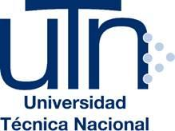

# Expediente del Proyecto

**Universidad Técnica Nacional · Sede Regional de San Carlos**
Ingeniería del Software · ISW-912 Administración de Proyectos Informáticos · 2026

**Proyecto:** Plataforma web de intermediación LESCO (puente de comunicación digital para la comunidad sorda de Costa Rica)

| Integrante | Cédula |
|---|---|
| Dylan Jiménez Alfaro | 2 0857 0199 |
| Emily Zúñiga Solano | 2 0861 0206 |

## Sección 00 · Scrum Team

Al ser un equipo de dos personas, cada integrante combina una responsabilidad de Scrum con el rol de Developer.

| Integrante | Rol en Scrum | Responsabilidades principales |
|---|---|---|
| **Emily Zúñiga Solano** | Product Owner + Developer | Ordena y refina el Product Backlog, valida los incrementos con usuarios e intérpretes y desarrolla la interfaz accesible (front-end). |
| **Dylan Jiménez Alfaro** | Scrum Master + Developer | Facilita los eventos de Scrum, elimina impedimentos, mantiene el tablero (Trello) y el repositorio, y desarrolla la lógica de datos del prototipo, la integración de la videollamada y el despliegue. |

> **Actualización (11/11/2026):** las responsabilidades de Dylan cambiaron de "back-end y base de datos" a "lógica de datos del prototipo, videollamada y despliegue", por la decisión D-02 (ver Sección 11). El tablero pasó de GitHub Projects a Trello (D-03).

## Índice del Expediente

| Sección | Archivo | Estado |
|---|---|---|
| 00 · Portada y Scrum Team | [00-portada-y-equipo.md](00-portada-y-equipo.md) | Completa |
| 01 · Problema, oportunidad y Product Goal | [01-problema-y-product-goal.md](01-problema-y-product-goal.md) | Completa (Product Goal actualizado) |
| 02 · Contexto organizacional y restricciones | [02-contexto-y-restricciones.md](02-contexto-y-restricciones.md) | Completa (restricciones actualizadas) |
| 03 · Interesados | [03-interesados.md](03-interesados.md) | Completa |
| 04 · Ciclo de vida y primer Sprint | [04-ciclo-de-vida-y-primer-sprint.md](04-ciclo-de-vida-y-primer-sprint.md) | Completa (ciclo de vida replanificado) |
| 05 · Backlog, Sprint Backlog y seguimiento | [05-backlog-y-seguimiento.md](05-backlog-y-seguimiento.md) | Completa (incluye Sprint Backlog 1 vigente) |
| 06 · Alcance y criterios de aceptación | — | Pendiente |
| 07 · Estimación y cronograma de entregas | [07-estimacion-y-cronograma.md](07-estimacion-y-cronograma.md) | Completa |
| 08 · Riesgos y adquisiciones | [08-riesgos-y-adquisiciones.md](08-riesgos-y-adquisiciones.md) | Completa |
| 09 · Calidad y Definition of Done | [09-definition-of-done.md](09-definition-of-done.md) | Completa |
| 10 · Comunicación y tablero de trabajo | [10-comunicaciones-y-tablero.md](10-comunicaciones-y-tablero.md) | Completa |
| 11 · Decisiones y cambios | [11-decisiones-y-cambios.md](11-decisiones-y-cambios.md) | En curso |
| 12 · Incremento final y cierre | — | Semana 13 |
| Historial de cambios | [historial-de-cambios.md](historial-de-cambios.md) | Se actualiza en cada entrega |

El detalle del Product Backlog y de los Sprint Backlogs está en [`docs/Backlog/Backlog.xlsx`](../Backlog/Backlog.xlsx).
