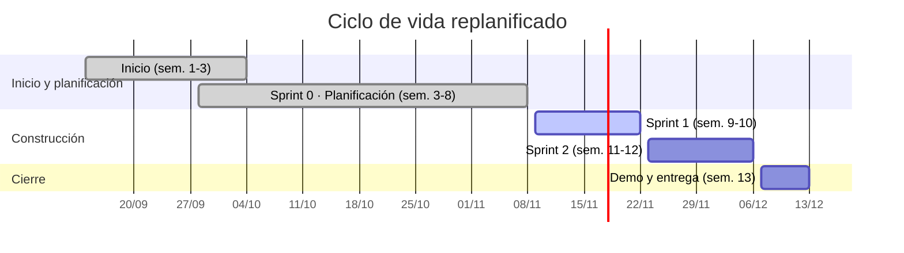
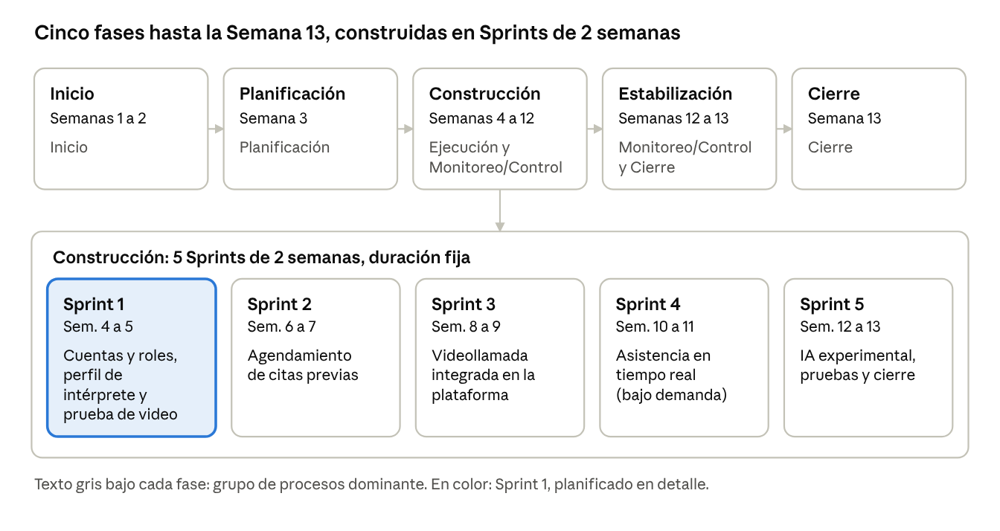

# Sección 04 · Ciclo de vida del proyecto y primer Sprint

## 4.1 Mapa del ciclo de vida (vigente desde el 11/11/2026)

El proyecto sigue un **ciclo de vida híbrido**: la fecha de cierre (Semana 13) es fija y el producto se construye de forma adaptativa en Sprints de 2 semanas. Las semanas 3 a 8 funcionaron como un **Sprint 0 de inicio y planificación**: en ellas se elaboró el Expediente (Product Goal, interesados, backlog, DoD, estimación, comunicación y riesgos) y no se construyó código. La construcción se hace en dos Sprints.

| Fase | Semanas | Fechas | Grupo de procesos dominante | Resultado |
|---|---|---|---|---|
| Inicio | 1 a 3 | 14 set – 4 oct | Inicio | Problema, Product Goal, Scrum Team |
| Planificación (Sprint 0) | 3 a 8 | 28 set – 8 nov | Planificación | Expediente, Secciones 00 a 10 |
| Construcción: Sprint 1 | 9 y 10 | 9 – 22 nov | Ejecución y Monitoreo/Control | Cuentas, consentimiento, interfaz accesible, disponibilidad del intérprete y prueba de videollamada |
| Construcción: Sprint 2 | 11 y 12 | 23 nov – 6 dic | Ejecución y Monitoreo/Control | Agendar una cita y realizarla por videollamada |
| Cierre | 13 | 7 – 13 dic | Cierre | Expediente completo, Informe Final, demo y defensa |

## 4.2 Sprint 1 de construcción (Semanas 9–10)

**Sprint Goal:** «Dejar construida la base de la plataforma: que una persona sorda y un intérprete puedan registrarse e iniciar sesión con su rol, que el intérprete publique su perfil y disponibilidad, y que se compruebe técnicamente que la videollamada es viable».

Se mantiene el mismo Sprint Goal del plan original, porque estas historias siguen siendo el cimiento del producto. El detalle (ítems, tareas y fechas) está en la [Sección 05, apartado 5.4](05-backlog-y-seguimiento.md#54-sprint-backlog-1-vigente-9-al-22-de-noviembre).

---

## Plan original (entregado en la Semana 3)

> Se conserva como registro. Fue reemplazado por la replanificación del 11/11/2026 (decisión D-01, [Sección 11](11-decisiones-y-cambios.md)).

El proyecto sigue un ciclo de vida híbrido: la fecha de cierre (Semana 13) es fija, y el producto se construye de forma adaptativa en cinco Sprints de 2 semanas.

*Figura 1. Mapa del ciclo de vida original: 5 fases y 5 Sprints. Debajo de cada fase aparece el grupo de procesos dominante; en color, el Sprint 1, planificado en detalle.*

### Primer Sprint original (Semanas 4–5)

**Sprint Goal:** «Dejar construida la base de la plataforma: que una persona sorda y un intérprete puedan registrarse e iniciar sesión con su rol, que el intérprete publique su perfil y disponibilidad, y que se compruebe técnicamente que la videollamada es viable».

**¿Por qué estas historias primero?**

- **Son el cimiento.** Casi todo lo demás (agendar citas, solicitar asistencia, videollamada) depende de que existan cuentas, roles y perfiles de intérprete.
- **Reducen el mayor riesgo técnico temprano.** La videollamada es el corazón del producto y la parte más incierta. Probarla en el Sprint 1 permite saber a tiempo si es viable y evita descubrirlo en la Semana 12.
- **Protegen la confianza del servicio.** Verificar que los intérpretes estén certificados es parte de la propuesta de valor y debe existir desde el principio.
- **Dejan fuera lo experimental.** La interpretación con IA no depende de ellas y puede esperar a que el núcleo funcione.

| ID | Historia o tarea | Prioridad | Criterio de aceptación resumido |
|---|---|---|---|
| **HU-01** | Como usuario (persona sorda o funcionario institucional), quiero registrarme e iniciar sesión para acceder a la plataforma. | Alta | Registro e inicio de sesión funcionan; cada cuenta tiene un rol asignado. |
| **HU-02** | Como administrador, quiero verificar la certificación LESCO de un intérprete para garantizar que solo intérpretes certificados atiendan. | Alta | El administrador puede aprobar o rechazar el perfil; solo los aprobados quedan visibles. |
| **HU-03** | Como intérprete, quiero registrar mi perfil y mi disponibilidad horaria para que me puedan agendar. | Alta | El intérprete guarda y edita su disponibilidad y esta se consulta correctamente. |
| **HU-04** | Como persona sorda, quiero una interfaz clara, visual y de lenguaje sencillo para usar la plataforma sin depender de un acompañante. | Media* | Estructura base de la interfaz con contraste adecuado, iconografía clara y textos simples. |
| **SP-01** | Prueba de concepto (spike) de videollamada entre dos navegadores. | Alta | Dos usuarios logran conectarse por video en un entorno de prueba y se documenta la tecnología elegida. |

\* En la Sección 05 la prioridad de HU-04 subió a **Alta**: la accesibilidad es una restricción de calidad del proyecto (WCAG 2.1 AA, Ley 7600), así que la interfaz base no puede quedar como "deseable".
