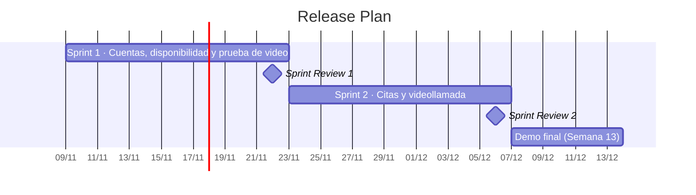

# Sección 07 · Matriz de Estimación y Cronograma de Entregas (Release Plan)

## 7.1 Matriz de Estimación

### Escala e historia de referencia

- **Unidad:** puntos de historia (tamaño relativo: esfuerzo, complejidad e incertidumbre; no son horas).
- **Escala:** Fibonacci **1 · 2 · 3 · 5 · 8 · 13**. Una historia de 13 se debe dividir antes de entrar a un Sprint.
- **Historia de referencia (3 puntos):** **HU-06 · Buscar intérpretes por fecha y hora.** Es una pantalla con un filtro sobre datos que ya existen. Las demás historias se estimaron comparándolas con ella ("¿es más grande o más pequeña que HU-06?").
- **Método:** planning poker entre los dos integrantes: cada uno elige su carta en secreto, se revelan al mismo tiempo, quien dio el valor más alto y el más bajo explican su razonamiento y se vuelve a votar hasta acordar.

### Matriz

| ID | Título | Épica | Prioridad | Puntos | Depende de | Release |
|---|---|---|---|---|---|---|
| HU-01 | Registro e inicio de sesión con rol | E1 Cuentas y privacidad | Alta | 5 | — | Sprint 1 |
| HU-05 | Consentimiento informado (Ley 8968) | E1 Cuentas y privacidad | Alta | 2 | HU-01 | Sprint 1 |
| SP-01 | Prueba de concepto de videollamada | E5 Videollamada | Alta | 3 | — | Sprint 1 |
| HU-02 | Verificación de la certificación del intérprete | E1 Cuentas y privacidad | Alta | 3 | HU-01, HU-03 | Opcional |
| HU-03 | Perfil y disponibilidad del intérprete | E3 Intérpretes | Alta | 5 | HU-01 | Sprint 1 |
| HU-04 | Interfaz base accesible | E2 Accesibilidad y calidad | Alta | 3 | — | Sprint 1 |
| HU-06 | Buscar intérpretes por fecha y hora | E4 Citas | Alta | 3 | HU-03 | Sprint 2 |
| HU-07 | Agendar una cita previa | E4 Citas | Alta | 5 | HU-06 | Sprint 2 |
| HU-08 | Aceptar o rechazar solicitudes de cita | E4 Citas | Alta | 3 | HU-07 | Sprint 2 |
| HU-09 | Cancelar o reagendar una cita | E4 Citas | Media | 3 | HU-07 | Futuro |
| HU-10 | Recordatorios visuales de citas | E4 Citas | Media | 3 | HU-07 | Futuro |
| HU-11 | Unirse a la videollamada de la cita | E5 Videollamada | Alta | 8 ⚠ | HU-07, SP-01 | Sprint 2 |
| HU-12 | Chat de texto en la videollamada | E5 Videollamada | Media | 3 | HU-11 | Opcional |
| HU-13 | Invitar al funcionario por enlace | E5 Videollamada | Media | 3 | HU-11 | Futuro |
| HU-14 | Historial de sesiones | E5 Videollamada | Baja | 2 | HU-11 | Futuro |
| HU-15 | Solicitar asistencia inmediata | E6 Tiempo real | Alta | 5 | HU-11 | Futuro |
| HU-16 | Estado "disponible ahora" del intérprete | E6 Tiempo real | Alta | 5 | HU-03 | Futuro |
| HU-17 | Posición en la fila y tiempo de espera | E6 Tiempo real | Media | 3 | HU-15 | Futuro |
| HU-18 | Calificar la sesión | E6 Tiempo real | Baja | 2 | HU-11 | Futuro |
| HU-19 | Guía rápida para funcionarios | E6 Tiempo real | Media | 2 | HU-11 | Futuro |
| HU-20 | Panel del administrador | E7 Administración | Media | 3 | HU-02 | Futuro |
| HU-21 | Interpretación experimental con IA | E8 IA experimental | Baja | 8 ⚠ | HU-11 | Futuro |
| TEC-01 | Pruebas de accesibilidad y despliegue final | E2 Accesibilidad y calidad | Alta | 3 | Todas las del release | Opcional |
| | | | | **85** | | |

⚠ **Historias para vigilar:** ninguna pasa de 8 puntos, pero HU-11 y HU-21 están en el límite. Si en el Sprint Planning del Sprint 2 HU-11 no cabe, se divide en *HU-11a · Abrir la llamada de la cita* (5) y *HU-11b · Solo los participantes pueden entrar* (3). HU-21 queda fuera de este release.

### Total por épica

| Épica | Ítems | Puntos | En este release |
|---|---|---|---|
| E1 Cuentas y privacidad | HU-01, HU-05, HU-02 | 10 | 7 (+3 opcional) |
| E2 Accesibilidad y calidad | HU-04, TEC-01 | 6 | 3 (+3 opcional) |
| E3 Intérpretes | HU-03 | 5 | 5 |
| E4 Citas | HU-06 a HU-10 | 17 | 11 |
| E5 Videollamada | SP-01, HU-11 a HU-14 | 19 | 11 (+3 opcional) |
| E6 Asistencia en tiempo real | HU-15 a HU-19 | 17 | 0 |
| E7 Administración | HU-20 | 3 | 0 |
| E8 IA experimental | HU-21 | 8 | 0 |
| **Total** | | **85** | **37 comprometidos + 9 opcionales** |

### Supuestos de la estimación

- Cada integrante dedica unas 15 horas por semana al proyecto (31 horas por Sprint de 2 semanas).
- El prototipo no tiene servidor: los datos se simulan en el navegador, lo que reduce el tamaño de las historias frente al plan original.
- La videollamada se incrusta con la API de Jitsi (JaaS) y no se programa desde cero.
- Los dos integrantes saben HTML, CSS y JavaScript; React se aprende durante el Sprint 1.

### Riesgos de la estimación

- **No hay velocidad histórica:** el Sprint 0 fue de planificación y no produjo puntos, así que la velocidad inicial es un supuesto.
- **Curva de aprendizaje de React** en el Sprint 1 (riesgo R-03).
- **HU-11** tiene la mayor incertidumbre: depende de que el servicio de Jitsi funcione incrustado (riesgo R-02). Por eso SP-01 va en el Sprint 1.

### Velocidad inicial y cómo se actualizará

| Escenario | Velocidad por Sprint | De dónde sale |
|---|---|---|
| **Máxima** | 21 puntos | La capacidad planificada en el Sprint 1 original: 21 puntos en 62 horas. |
| **Mínima** | 13 puntos | Unos dos tercios de la máxima, por la curva de aprendizaje y las entregas de otros cursos a fin de cuatrimestre. |

La velocidad real se mide al cerrar cada Sprint, contando **solo** las historias que cumplen la DoD, y se anota en la Retrospectiva. Con la velocidad real del Sprint 1 (22 de noviembre) se ajusta el compromiso del Sprint 2.

### Registro de la sesión de planning poker

*(El equipo completa esta tabla con las historias en las que hubo más diferencia.)*

| Historia | Carta de Emily | Carta de Dylan | Acuerdo | ¿Qué se discutió? |
|---|---|---|---|---|
| | | | | |
| | | | | |
| | | | | |

## 7.2 Cronograma de Entregas (Release Plan)

### Datos base

| Dato | Valor |
|---|---|
| Duración del Sprint | 2 semanas (fija) |
| Inicio del Sprint 1 de construcción | Lunes 9 de noviembre de 2026 |
| Backlog comprometido para el release | 37 puntos |
| Sprints disponibles antes del cierre | 2 (semanas 9 a 12) |

### Sprints necesarios (rango)

**Backlog comprometido ÷ velocidad = Sprints necesarios**

| Velocidad | Cálculo | Sprints necesarios |
|---|---|---|
| Máxima (21) | 37 ÷ 21 = 1,8 | **2 Sprints** |
| Mínima (13) | 37 ÷ 13 = 2,8 | **3 Sprints** |

El rango honesto es **entre 2 y 3 Sprints**, y solo hay 2. Por eso el compromiso se ordena para que lo más valioso quede primero, y se define desde ya qué se recorta si la velocidad real sale baja:

1. No se toma ningún opcional (HU-02, TEC-01, HU-12).
2. HU-11 se simplifica: la llamada abre en una pestaña nueva con el enlace de la cita, en lugar de ir incrustada (baja de 8 a unos 3 puntos).
3. HU-08 se simplifica: las citas quedan aceptadas automáticamente y el intérprete solo las ve en su agenda.

Así, aun con la velocidad mínima, la demo de la Semana 13 muestra el recorrido completo: registrarse, publicar disponibilidad, agendar y entrar a la videollamada.

### Qué Incremento sale en cada Sprint

| Sprint | Fechas | Incremento | Historias | Puntos |
|---|---|---|---|---|
| Sprint 0 | 28 set – 8 nov | Planificación del proyecto (Expediente, Secciones 00 a 10). Sin código. | — | 0 |
| **Sprint 1** | 9 – 22 nov | Una persona sorda o un intérprete se registra con su rol y acepta el aviso de privacidad; el intérprete publica su disponibilidad; hay una llamada de prueba funcionando. Interfaz base accesible. | HU-01, HU-05, HU-04, HU-03, SP-01 | 18 |
| **Sprint 2** | 23 nov – 6 dic | La persona busca un intérprete, agenda una cita, el intérprete la acepta y ambos entran a la videollamada desde la plataforma. | HU-06, HU-07, HU-08, HU-11 (+ opcionales) | 19 |
| Cierre | 7 – 13 dic | Demo final, Informe Final y defensa. Sin desarrollo nuevo. | — | — |

### Hitos de entrega

| Fecha | Hito |
|---|---|
| 22 nov | **Sprint Review 1:** se muestra el Incremento 1 (registro, disponibilidad y llamada de prueba). Se presenta al docente en la clase de la Semana 11. |
| 6 dic | **Sprint Review 2:** Incremento 2 con el recorrido completo; funciona como ensayo general de la demo. |
| Semana 13 | **Demo final y defensa** ante el docente, con el Expediente completo. |

### Costo estimado

El proyecto no tiene presupuesto monetario (₡0), pero el costo dominante en Scrum es el tiempo del equipo, así que se estima con una **tarifa hipotética de ₡5 000 por hora** de un estudiante avanzado.

| Concepto | Cálculo | Costo |
|---|---|---|
| Equipo por Sprint | 62 h × ₡5 000 | ₡310 000 |
| Herramientas (GitHub, Trello, Vercel, JaaS) | Planes gratuitos | ₡0 |
| **Costo por Sprint** | | **₡310 000** |
| **Costo del release (2 Sprints)** | ₡310 000 × 2 | **₡620 000** |
| Rango si se necesitaran 3 Sprints | ₡310 000 × 3 | ₡930 000 |

- El tiempo del Sprint 0 es un **costo hundido**: ya se gastó y no influye en las decisiones de aquí en adelante.
- Como el presupuesto (y la fecha) son fijos, la reserva de contingencia es el **alcance**: si falta tiempo, se entrega lo más valioso ya construido y se recorta en el orden indicado arriba.

## 7.3 Seguimiento: burndown del release

Al cerrar cada Sprint se anotan los puntos que quedan del compromiso de 37. Si la línea real queda por encima de la ideal, vamos atrasados y se aplica el orden de recorte.

| Momento | Ideal (puntos pendientes) | Real (puntos pendientes) |
|---|---|---|
| Inicio (9 nov) | 37 | 37 |
| Fin del Sprint 1 (22 nov) | 19 | *(completar)* |
| Fin del Sprint 2 (6 dic) | 0 | *(completar)* |

También se usa el **SPI = puntos terminados ÷ puntos planificados**. Si es menor que 1, vamos atrasados.
